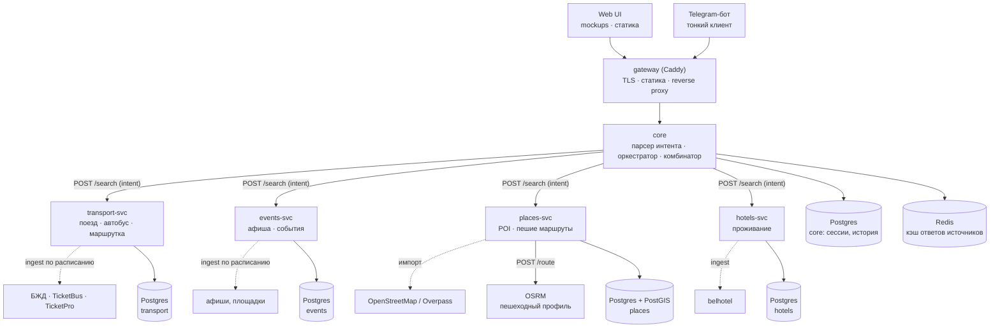
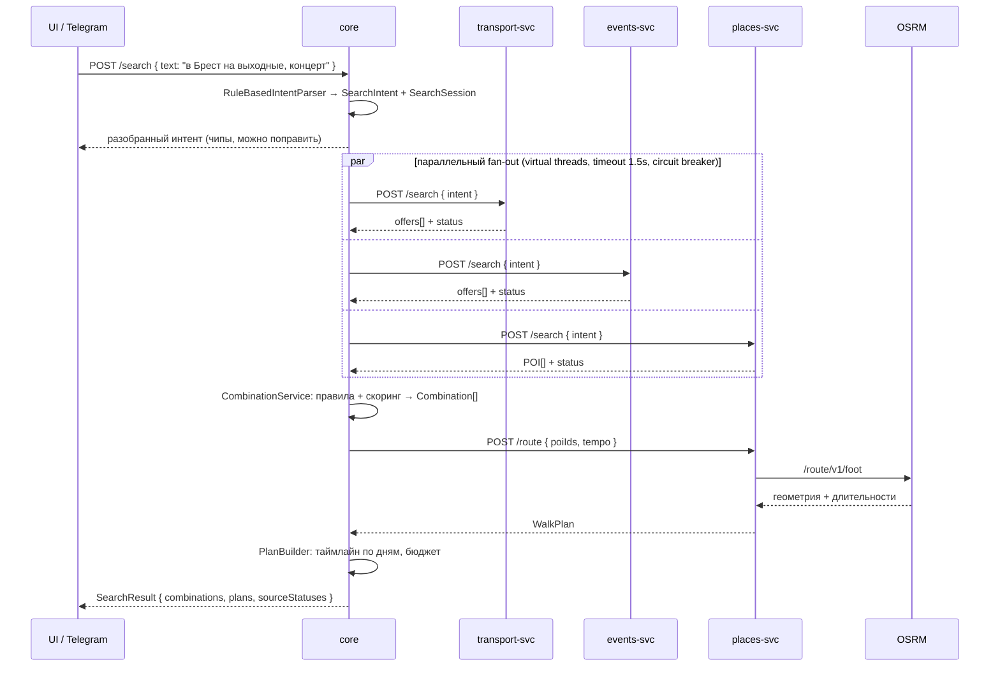
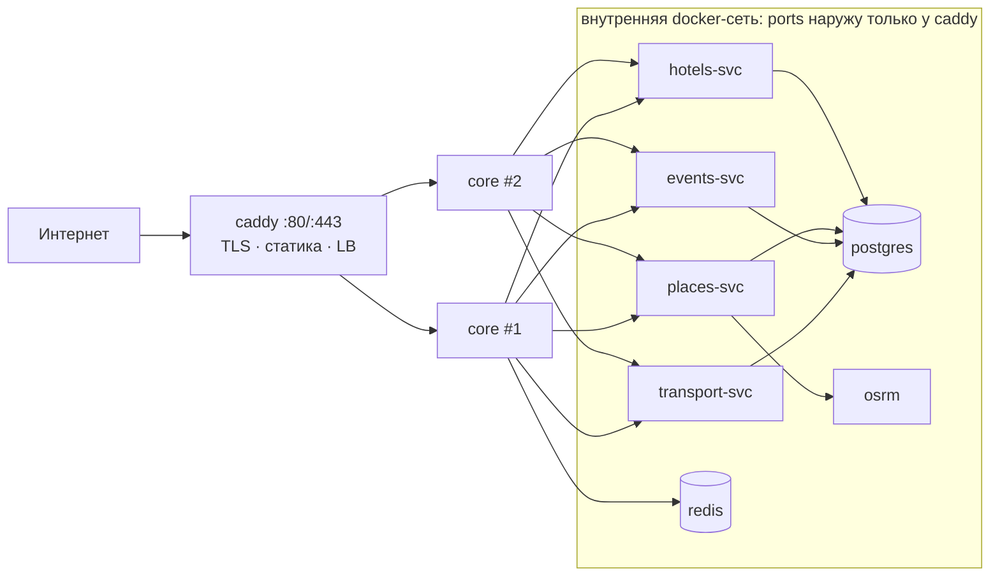

# Storm Trip — архитектура планировщика поездок без нейросетей

Документ описывает целевую архитектуру: ядро принимает запрос пользователя, разбирает его
в формальный `SearchIntent` **правилами** (без LLM), рассылает интент сервисам-источникам,
собирает офферы и комбинирует их в готовые планы поездки — включая план прогулок по местам.

## 1. Что строим

Пользователь пишет: «Хочу в Брест на выходные, рок-концерт, до 300 BYN, можно маршруткой».
Система должна вернуть готовые варианты поездки:

```
транспорт (поезд / автобус / маршрутка)
  + событие (концерт, фестиваль, выставка)
  + проживание (опционально)
  + пешая прогулка по местам (маршрут с временем и точками)
  = план поездки на N дней с бюджетом и таймлайном
```

Ключевое решение: **никаких нейросетей**. «Умность» даёт комбинация четырёх вещей:

1. Rule-based разбор текста в интент (словари, паттерны, fuzzy-матчинг справочников).
2. Единый формальный контракт `SearchIntent` — сервисы не парсят текст, а получают структуру.
3. Правила совместимости и скоринг комбинаций (уже частично реализованы).
4. Алгоритм построения пешего маршрута (ближайший сосед + 2-opt, время по OSRM).

Это детерминированно, бесплатно, тестируется unit-тестами и не зависит от внешних API.

## 2. От LLM к правилам

В коде уже заложен порт `IntentParser`, у которого две взаимозаменяемые реализации
(`LlmIntentParser` и `RuleBasedIntentParser`). Удаление нейросети — это удаление одной
реализации и обогащение второй:

| Что убрать | Что вместо |
|---|---|
| `spring-ai-starter-model-openai`, `LlmIntentParser` | `RuleBasedIntentParser` + словари синонимов |
| Свободный текст между ядром и провайдерами | Строгий JSON-контракт `SearchIntent` |
| «Понимание» как магия | Справочники: 995 станций (`stations_by.json`), 126 отелей BelHotel |

Как устроен разбор (всё уже начато в `RuleBasedIntentParser`):

- **Нормализация**: регистр, ё/е, транслит, опечатки — SymSpell-подобный словарь по справочнику станций.
- **Города/станции**: «из Минска в Брест» → fuzzy-матч по справочнику станций + алиасы («Питер» → Санкт-Петербург).
- **Даты**: паттерны «на выходные», «24–26 октября», «завтра», «на майские».
- **Домены**: «концерт/фестиваль/выставка» → `EVENT`; «поезд» → `TRAIN`; «маршрутка/автобус» → `BUS`;
  «отель/гостиница/переночевать» → `HOTEL`; «погулять/достопримечательности/посмотреть город» → `WALK`.
- **Бюджет/пассажиры/звёзды**: «до 300», «на двоих», «2 взрослых и ребёнок», «только 4 звезды».
- **Уточнения**: «дешевле», «без отелей», «ещё ребёнок» → существующие sealed-команды
  (`ChangeBudget`, `AddDomain`, `ChangePassengers`, …).

Ошиблись в разборе — не страшно: результат парсинга показывается пользователю **чипами**,
любой чип редактируется вручную (см. макет «Поиск»). Это дешёвая замена «исправь сам понимаешь что».

## 3. Карта сервисов



Принципы:

- **Ядро не знает о внешних сайтах.** Оно знает только HTTP-контракт «интент → офферы».
  Парсеры БЖД/TicketBus живут внутри `transport-svc`, афиши — внутри `events-svc`.
- **Каждый сервис — владелец своей БД и своих сборщиков.** Никто не ходит в чужую БД.
- **Порт `SearchProvider` превращается в HTTP-клиент.** В коде ядра список провайдеров
  заменяется списком `SearchProviderClient` (по одному на сервис), локальные парсеры
  переезжают в свои сервисы без изменения доменной модели.
- **Новый домен `WALK`** добавляется в `DomainType`. `places-svc` умеет две вещи:
  отдать POI как офферы (`POST /search`) и собрать пеший маршрут из выбранных точек (`POST /route`
  через OSRM). План прогулки строит ядро — это часть комбинации, а не отдельный «умный» сервис.

## 4. Контракты

Единственный язык между сервисами — JSON. Схема `SearchIntent` (соответствует существующей
Java-модели, добавляются `WALK` и `places`-критерии):

```json
{
  "domains": ["TRAIN", "EVENT", "WALK"],
  "route": {
    "from": { "id": "msq", "name": "Минск", "coordinates": { "latitude": 53.9006, "longitude": 27.5590 } },
    "to":   { "id": "bqt", "name": "Брест", "coordinates": { "latitude": 52.0976, "longitude": 23.7341 } }
  },
  "dates": { "from": "2026-10-24", "to": "2026-10-26" },
  "passenger": { "adults": 1, "children": 0 },
  "transport": { "directOnly": false, "window": "MORNING", "excludeWindow": "NIGHT" },
  "event": { "query": "концерт", "window": "EVENING" },
  "hotel": { "minRating": 3, "nearVenue": true, "center": false },
  "preferences": { "sort": "BEST", "budgetMax": 300, "compare": true, "geoView": false }
}
```

Типы значений уже зафиксированы в коде: `DomainType {BUS, TRAIN, EVENT, HOTEL}` (+`WALK`),
`TimeWindow {ANY, MORNING, AFTERNOON, EVENING, NIGHT}`, `SortType {CHEAPEST, FASTEST, BEST}`.

Ответ сервиса — офферы + статус (контракт `SourceResult` уже есть):

```json
{
  "source": "BZD",
  "status": "SUCCESS",
  "offers": [
    {
      "type": "TRANSPORT",
      "id": "bzd-742Б-2026-10-24",
      "domain": "TRAIN",
      "title": "742Б Минск-Пасс. → Брест-Центр.",
      "from": { "name": "Минск", "coordinates": { "latitude": 53.8905, "longitude": 27.5497 } },
      "to":   { "name": "Брест", "coordinates": { "latitude": 52.0979, "longitude": 23.6858 } },
      "departure": "2026-10-24T06:42:00+03:00",
      "arrival":   "2026-10-24T10:40:00+03:00",
      "price": { "amount": 12.50, "currency": "BYN" },
      "direct": true,
      "url": "https://pass.rw.by/..."
    }
  ]
}
```

Ядро собирает `Combination` (тоже уже есть) и расширяет её до `TripPlan`: таймлайн по дням,
слоты прогулок, итоговый бюджет, ссылки на покупку. `SourceStatus {SUCCESS, EMPTY, FAILED}`
показывается пользователю прямо в UI (панель «Источники») — прозрачность данных бесплатно.

## 5. Поток поиска



Уточнения работают поверх сессии: «дешевле» → `ChangeSort(CHEAPEST)`, «без отелей» →
`AddDomain` → повторная сборка только в ядре (офферы уже в кэше), без новых внешних запросов.

## 6. Сборка комбинаций и план прогулки

Уже реализовано в `DefaultCombinationService` и сохраняется:

- событие начинается не раньше чем через 2 часа после прибытия транспорта (`MIN_EVENT_GAP`);
- отель не дальше 2 км от площадки (`MAX_DISTANCE_KM`, haversine);
- суммарная цена ≤ бюджет;
- скоринг: прямой рейс +0.2, рейтинг отеля, комфортный зазор до события +0.2/0.1;
- теги: `direct`, `top rated`, тип комбинации.

Добавляется для прогулок (Фаза 2):

- `places-svc` хранит POI с категориями (достопримечательность, гастро, парк, площадка) и временем осмотра;
- ядро вырезает **свободные окна** из таймлайна (между прибытием и событием, утро второго дня);
- подбор точек под окно: филтр по категориям из интента → ближайший сосед → 2-opt на матрице
  пеших расстояний OSRM → проверка «успеваем к событию»;
- результат: точки с временем прихода, длительность, километраж; вставляется в `TripPlan` как день 2, 10:00–13:30.

## 7. Распределение нагрузки

Горячий путь — **поиск** (пользователь ждёт), холодный — **ingest** (сбор данных).
Разделяем их жёстко.

Горячий путь:

- Fan-out **параллельный**, а не циклом как сейчас: `CompletableFuture` + virtual threads.
  Медленный источник не задерживает остальные: timeout 1.5 s на вызов.
- **Circuit breaker + bulkhead** на каждый источник (Resilience4j): БЖД лежит — поиск
  всё равно отвечает комбинациями без поездов, со статусом `FAILED` в панели источников.
- **Redis-кэш** по хэшу интента, TTL 5–15 минут. Популярные маршруты («Минск–Брест на выходные»)
  обслуживаются из кэша почти мгновенно и снимают нагрузку и с сервисов, и с внешних сайтов.
- Сервисы **stateless** → горизонтально масштабируются за Caddy. Ядро — самый горячий, начинаем
  с 2 реплик; сервисы данных реплицируются только если понадобится.
- Ingest-вьюхи (расписания, афиша) — обычные postgres-таблицы с индексами
  `(route, date)` для транспорта и GIST-индексом гео для POI. Поиск никогда не ходит
  на внешний сайт синхронно — только в свою БД.

Холодный путь (ingest):

- Каждый сервис обновляет данные **по расписанию** (`@Scheduled`): расписания — раз в сутки ночью,
  афиша — каждые 6 часов, POI — раз в неделю. Ночная загрузка не конкурирует с пользователями.
- Вежливость к источникам: ≤ 1 запрос/сек на домен, backoff при 429/5xx, User-Agent, robots.txt.
- Тяжёлый ingest можно вынести в отдельный worker-контейнер того же сервиса
  (тот же код, отдельный деплоймент) — это единственное место, где масштабирование реально нужно.

Чего **не** делаем на старте: Kafka, Kubernetes, Elasticsearch, CQRS-фреймворки. Когда появится
второй хост или real-time обновления — меняется только транспорт между ядром и сервисами
(порт уже выделен), доменная модель остаётся.

Ориентиры по ресурсам (compose-лимиты):

| Сервис | Лимит RAM | Примечание |
|---|---|---|
| core | 512 MB | +2 реплики при росте |
| transport-svc | 384 MB | ingest тяжёлый, но ночью |
| events-svc | 384 MB | |
| places-svc | 384 MB | PostGIS в отдельной БД |
| hotels-svc | 256 MB | самый простой |
| postgres | 1 GB | одна инстанция, БД на сервис |
| redis | 128 MB | `maxmemory`, вытеснение LRU |
| osrm | 512 MB | только пешеходный профиль |
| caddy | 64 MB | единственная точка входа |

## 8. Стек

| Вариант | Плюсы | Минусы | Вердикт |
|---|---|---|---|
| **Java 21 + Spring Boot 4** (как сейчас) | Домен, парсеры, модели уже написаны; virtual threads для fan-out; Resilience4j, Spring Data, Actuator | ~300–400 MB на сервис | **Рекомендация** |
| Go | Лёгкие сервисы, быстрый старт | Переписывать весь домен; парсинг HTML беднее | Нет |
| Python (FastAPI) | Лучший для скрейпинга | Второй язык в команде; GIL; переписывать ядро | Только если парсеры станут болью |
| Quarkus | Java, но лёгкий (100 MB, старт <1 s) | Команда не знает; экосистема реже | Запасной, если упрёмся в RAM |

Стек целиком:

- **Backend**: Java 21, Spring Boot 4 (webmvc + RestClient), Maven multi-module монорепо:
  `services/core`, `services/transport`, `services/events`, `services/places`, `services/hotels`,
  `shared/contracts` (модели интента/офферов — одна копия на все сервисы).
- **Frontend**: статический SPA без сборки (vanilla JS + fetch), раздаётся Caddy.
  Макеты в `mockups/` — готовая основа. Telegram-бот — тонкий клиент к тому же API.
- **Данные**: Postgres 16 + PostGIS (places), Redis 7 (кэш), OSM/Overpass (импорт POI), OSRM (пешие маршруты).
- **Инфра**: Docker Compose, Caddy (TLS автоматом), GitLab CI (lint → test → build → deploy по SSH),
  Prometheus + Grafana + cAdvisor (метрики, панель по `SourceStatus`).

## 9. Топология деплоя



Правила: наружу торчит только caddy; каждый сервис имеет healthcheck; `depends_on:
service_healthy`; рестарты `unless-stopped`; секреты — только в `.env`/CI-переменных;
бэкап — `pg_dump` по расписанию наружу из контейнера.

## 10. Фазы внедрения

1. **MVP (ядро + транспорт)**: выпилить Spring AI; параллельный fan-out; `transport-svc`
   с существующими парсерами и справочником станций; комбинации транспорт+событие;
   web UI по макетам 1–3. Events-данные на этом этапе можно отдать из `events-svc` с одним парсером.
2. **Прогулки**: `places-svc` (PostGIS + импорт OSM + OSRM), домен `WALK`, PlanBuilder,
   макет 4. Это самая заметная «умная» фича без единой нейросети.
3. **Проживание и полировка**: hotels как полноценный сервис, refine-команды до конца,
   история/сессии из UI, мониторинг источников.
4. **По вкусу**: Telegram-бот, персонализация (избранное, «как в прошлый раз»), второй хост.

## 11. Интерфейс

Макеты — `mockups/index.html` (открыть в браузере, без сборки):

1. **Поиск** — строка естественного запроса + разобранные чипы интента (правятся), структурная форма,
   панель источников. Показывает, что «понимание» — это правила, а не магия.
2. **Результаты** — карточки комбинаций: состав, цена, скоринг, теги, статусы источников.
3. **План поездки** — таймлайн по дням (транспорт → check-in → событие → прогулка), бюджет,
   карта, кнопки покупки. Сюда встраивается план прогулки.
4. **Прогулка** — карта с точками и пешим маршрутом, список мест с временем, темп, километраж.
